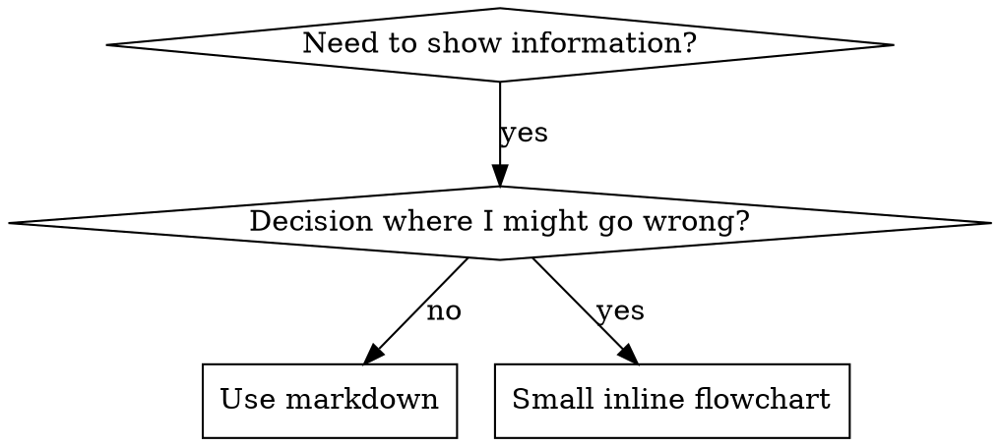

# Skills 中的流程图

属于 superpowers:writing-skills。

## 流程图用法



**仅在以下情况使用流程图：**
- 不明显的决策点
- 你可能会过早停止的流程循环
- “何时使用 A 与 B”的决策

**绝不要将流程图用于：**
- 参考资料 → 表格、列表
- 代码示例 → Markdown 块
- 线性指令 → 编号列表
- 没有语义含义的标签（step1、helper2）

graphviz 样式规则见本目录中的 `graphviz-conventions.dot`。

**为 human partner 可视化：** 在 writing-skills 目录中运行 `render-graphs.js`，把 skill 的流程图渲染为 SVG：
```bash
node ./render-graphs.js ../some-skill           # 每张图单独输出
node ./render-graphs.js ../some-skill --combine # 所有图合并到一个 SVG
```
